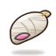

# ShivBodh Trust – Global Icon Kit (brief for final artwork)

Status: **prototypes ready, final artwork pending approval.**
This folder is the single source of truth for every icon used on shivbodhtrust.org.
The theme will load icons only from `final/` after the trustee approves them.

> Temporary public workspace. After approval the final icons move into the private ShivBodh Trust site repo and this repository will be deleted.

## For the AI / designer who generates the final icons

1. Read this file and `prompts.json` (same data, machine-readable).
2. For every icon in the table, generate an image using **STYLE + Subject prompt** (and the NEGATIVE prompt if your tool supports it).
3. Save each result as `final/png/<name>.png` – exact `name` from the table, lowercase, hyphens.
4. Do **not** edit `prototypes/`, theme files, or anything outside `final/`.
5. Commit on a branch and open a pull request titled `icons: final artwork batch <n>`.
6. In `prompts.json` set `"status": "done"` for each icon you delivered.

The prototypes in `prototypes/` show the composition and colours only. The final art must be **far more realistic and devotional** than the prototypes.

### STYLE (prepend to every prompt)
> Traditional Indian devotional oil painting, single sacred object centered, realistic 3D form, visible painterly brush strokes, thin dark-brown ink outline, warm divine golden rim light from top-left, glossy varnish highlights, real gold-leaf ornament details, saffron, maroon and gold palette, sacred Kashi and Sanskrit gurukul atmosphere, isolated object on a fully transparent background, no text, no letters, no frame, no border, no square background, only a soft contact shadow under the object, ultra detailed, sharp focus, icon composition with about 8 percent padding on every side.

### NEGATIVE
> text, letters, watermark, signature, frame, border, square tile, background scene, sky, wall, cartoon flat vector, emoji style, blurry, low detail, cropped object, extra hands or fingers, religious symbols of other faiths, Kaaba

### Technical acceptance criteria (every icon must pass)
- 1024 × 1024 px PNG, RGBA, **truly transparent** background (no white, no checkerboard baked in).
- One object only, centered, ~8 % padding; nothing cropped.
- Light comes from the top-left; gold rim light and glossy highlight visible.
- Must read clearly at **32 px** (test by shrinking) and look rich at 256 px.
- Works on both cream `#FFFAF3` and dark `#1A1209` backgrounds.
- No text, no watermark, no symbols of other faiths.
- All icons in the set share the same lighting, outline weight and palette.

Reference mood: a classic Hindu devotional painting (for example a meditating Hanuman ji illustration) – dark ink outline, painted gradient shading, gold ornaments, glossy highlight, no background.

## Icon list

Priority **A** = replaces an emoji on the live site now. **B** = decorative / future use.

| # | Pri | name | Title | Prototype | Replaces | Used on | Subject prompt |
|---|-----|------|-------|-----------|----------|---------|----------------|
| 1 | A | `om` | Om |  | 🕉 &#128329; and the wrong 🕋 &#128331; | front-page hero, footer, contact | sacred Om symbol sculpted in glowing saffron and polished gold, with crescent and bindu, soft halo of divine light behind it, a few marigold petals at the base |
| 2 | A | `vidyarthi-sahyog` | Vidyarthi Sahyog |  | 📚 &#128218; | Vidyarthi Sahyog project card, contact | open palm-leaf Sanskrit manuscript resting on a carved rosewood vyasapeetha book stand, rudraksha mala draped beside it, a small glowing brass diya, gurukul feeling |
| 3 | A | `veda-parayana` | Veda Parayana Sahyog |  | project card (no emoji yet) | Veda Parayana project card | rolled Vedic scroll tied with red sacred kalava thread, wooden rollers with brass caps, a tulsi sprig and a few rose petals, warm lamp light |
| 4 | A | `gau-mata-seva` | Gau Mata Seva |  | 🐄 &#128004; | Gau Mata Seva project card, contact | gentle sacred Indian cow face (gau mata), cream white, red kumkum tilak on the forehead, golden painted horns with red tassels, marigold garland and a small brass bell at the neck, calm kind eyes |
| 5 | A | `annadeva-yojana` | Annadeva Yojana |  | 🍲 &#127858; | Annadeva Yojana project card, contact | polished brass bowl heaped with white rice and dal on a fresh green banana leaf, a tulsi leaf on top, gentle steam, prasad feeling |
| 6 | A | `namaste` | Namaste / Pranam |  | 🙏 &#128591; | welcome and thank-you text | two hands joined in pranam namaste, red kalava thread on the wrist, sandalwood skin tone, soft temple light |
| 7 | A | `sahyog` | Sahyog / Partnership | none | 🤝 &#129309; | volunteer / partnership text | two hands clasping in support, one wearing a red kalava thread and the other a rudraksha bracelet, warm saffron light |
| 8 | A | `announcement` | Shankh / Announcement |  | 📣 | notices and announcements | sacred white shankh conch with a gold-capped tip and red thread, rays of golden sound light coming out of its mouth |
| 9 | A | `verify` | Verify / Search |  | 🔍 🔎 &#128269; &#128270; | search and verification links | antique brass magnifying glass lying over a palm-leaf manuscript |
| 10 | A | `branches` | Branches / Reach |  | 🌐 &#127760; | branches and reach sections | brass globe on a carved wooden stand, saffron points of light marking places, a small Om engraved on the base |
| 11 | A | `mail` | Email |  | 📧 &#128231; | contact page email row | parchment envelope sealed with red wax bearing an Om seal, tied with red thread |
| 12 | A | `location` | Address |  | 📍 &#128205; | contact page address row | saffron map pin with a small golden temple shikhara inside its circle |
| 13 | B | `kashi-temple` | Kashi Mandir |  | - | about / heritage | Kashi Vishwanath style Nagara temple shikhara in sandstone with a golden kalash finial and a saffron flag, faint Ganga ghat steps at its base |
| 14 | B | `diya` | Diya |  | - | devotion accent | hand-made clay diya with a bright warm flame, kumkum dots on the rim, soft divine glow |
| 15 | B | `lotus` | Kamal |  | - | purity accent | fully bloomed pink lotus on a lotus leaf with water droplets |
| 16 | B | `kalash` | Kalash |  | - | auspicious accent | polished brass kalash with five mango leaves, a coconut wrapped in red cloth, red swastika and kumkum marks |
| 17 | B | `donate-heart` | Daan / Donate |  | - | donate button | two cupped hands offering a heart made of marigold and rose petals with a gold coin |
| 18 | B | `knowledge` | Gyaan / Knowledge |  | - | blog / learning | open ancient Sanskrit book with radiant golden light rising from the pages, a faint Saraswati veena silhouette in the glow |
| 19 | B | `checklist` | Checklist |  | - | verified points | wooden writing patti with a parchment sheet and three green tick marks, a peacock feather quill |
| 20 | B | `phone` | Phone |  | - | contact page phone row | classic brass and maroon telephone handset, polished glossy finish |
| 21 | B | `volunteers` | Volunteers |  | - | team / seva | two smiling Indian sevaks in saffron and white kurta with gamchha, chest-up portrait |

Full prototype sheet: `prototypes/preview.png`

## Small UI symbols (not paintings)

These appear at 14–18 px, so they will be crisp gold line SVGs drawn in code, not AI paintings. Do not generate these.

| name | Replaces | Used on |
|------|----------|---------|
| `theme-light` | ☼ &#9788; | header dark/light toggle |
| `theme-dark` | ☾ &#9790; | header dark/light toggle |
| `section-mark` | ✦ &#10022; | section labels (front-page, about, projects) |
| `check` | ✓ &#10003; | tick lists |
| `arrow-right` | ➔ &#10132; → &#8594; | buttons / links |
| `arrow-left` | ← &#8592; | back links |
| `caret` | ▲ &#9650; ▾ &#9662; | scroll-top, menu |

## After delivery (maintainer steps)

1. Check every PNG against the acceptance criteria and show the trustee a preview.
2. On approval: trim, export WebP (64/128/256 px) into `final/webp/`, and add them to the theme `assets/icons/`.
3. Replace each emoji with `shivbodh_icon( '<name>' )`. Back up, deploy, purge cache and verify live.
